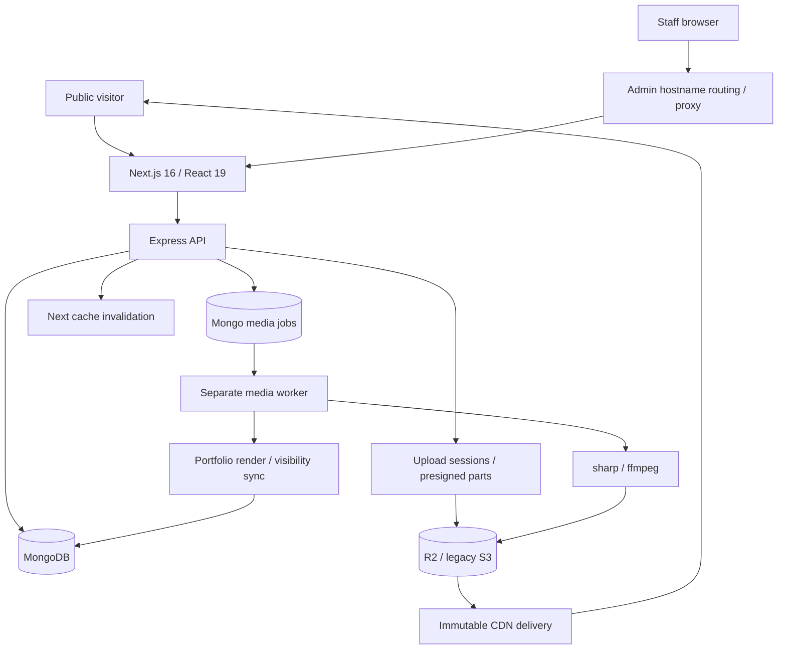

# WeddingBoys: deep project analysis

**Review date:** 31 October 2026 (India).  
**Repository:** `/Users/akshaysingh/Documents/WebDev/web/weddingBoys`.  
**Reviewed state:** current working tree, including the existing uncommitted film and photo redesign. No application source was changed for this review.

## Assessment

WeddingBoys has a substantial, useful foundation for running a wedding studio. Its strongest work is the separation of weddings, portfolio placements, underlying media, curated collections, and page composition. Server rendering, immutable media delivery, asynchronous processing, and staff publishing tools are already implemented.

The main weakness is uneven integration between generations of the application. New authentication coexists with a legacy profile API; new collection settings reach an old feed adapter; new photo navigation changes the address without updating page metadata; upload and processing stages have failure windows between database writes. These boundaries deserve attention before more feature expansion.

**I would retain the architecture and prioritize security, enquiry conversion, and consistency repairs.** Passing production builds do not establish readiness: the current tree also has a serious cross-account profile write, forgeable draft previews in a missing-secret configuration, caller-controlled enquiry email recipients, incomplete MFA lock enforcement, and frontend state races.

This is an evidence-based engineering review, not a certification of the deployed service. Production configuration, backups, traffic, search rankings, and actual conversion rates were not available.

## 1. Scope and verification

The inventory contains approximately **474 JS/JSX/MJS/CSS files and 93,507 source lines**, including comments and styles; **28 backend models**, **18 public page modules**, and **31 admin page modules**. Dynamic page modules can serve many URLs. Counts exclude dependencies and generated Next output.

I traced the principal public, authentication, portfolio, media, CMS, blog, and enquiry paths; read project context and historical audit material; inspected local pages in the browser; ran the existing checks; and used isolated model/SMTP stubs to validate sensitive controller behavior. I did not read every source line or exercise every authenticated admin control.

| Check | Result | Meaning |
|---|---|---|
| Backend `npm test` | **29 passed, 0 failed** | Existing domain tests pass |
| Frontend `npm run prebuild` | **Passed** | 27 editor nodes registered; Tailwind utility check passes |
| Frontend `npm run lint` | **28 errors, 15 warnings** | The current lint gate fails |
| Default `npm run build` / Turbopack | **Passed with network access** | Current app compiles and generates production routes |
| `npm run build -- --webpack` | **Passed with network access** | Independent compiler path also passes |
| Backend dependency audit | **23 flagged packages** | 2 critical, 11 high, 9 moderate, 1 low |
| Frontend dependency audit | **65 flagged packages** | 1 critical, 10 high, 54 moderate |
| Missing film and photo HTTP probes | **Both returned 200** | Not-found UI does not produce correct HTTP status |
| Local sitemap | **200, 79 URLs** | Sitemap works at the current data size |

Initial sandboxed build attempts could not complete font acquisition; the Webpack attempt explicitly failed to reach Google Fonts. Both builds passed after network access was allowed. Turbopack reported one nonfatal warning: the imported Varanasi AVIF texture is emitted without optimization. The first stalled build was stopped. This was an environment restriction, not evidence of a source compilation failure.

The API was initially unavailable and subsequently became available during the review. Early screenshots showed failed studio-detail loading; later checks exercised real local content. Development data changed during the review, so exact content counts are observations, not a frozen production inventory.

Evidence is saved beside this report:

- `2026-10-31-weddingboys-evidence.json`: check results, isolated probes, HTTP observations, dependency details and advisory links.
- `2026-10-31-lint.txt`: full lint output.
- `2026-10-31-build-turbopack.txt` and `2026-10-31-build-webpack.txt`: successful build logs.

## 2. Product and business model

There are four practical products in the repository:

1. **A discovery and conversion site:** films, photographs, studio/team information, prices, destination pages, contact, Varanasi, and Dharaa.
2. **A portfolio publishing system:** weddings, ceremony chapters, uploaded or externally hosted films, credits, ordering, covers, visibility, and collection placement.
3. **An editorial CMS:** a structured TipTap editor, several article templates, media blocks, previews, revisions, scheduling, comments, and analytics.
4. **A staff workspace:** accounts, MFA, invitations, content, uploads, enquiries, pricing, and global settings.

The most valuable public journey is:

**Discover a film or destination → inspect a full wedding → trust the studio's work and team → enquire with a date and location → receive a prompt response.**

The application supports most of that journey, but the last step is weaker than the content system. An elaborate editor has less commercial value if a booking enquiry silently fails validation or a WhatsApp link has no destination.

Wedding story pages are a particularly useful investment: they connect film, photographs, ceremony, place, and crew into one coherent case study. They can support both prospect evaluation and editorial linking. Destination pages and journal articles should lead to relevant real weddings and then carry their context into the enquiry.

The lead system currently models roughly “new” versus “viewed.” It does not yet provide a complete sales pipeline with assigned owner, next follow-up, quote, booked/lost outcome, or measured acquisition attribution. That is an opportunity after the enquiry path is reliable, not a reason to build a large CRM immediately.

## 3. Architecture and data flow

### Core domain

| Entity | Responsibility | Assessment |
|---|---|---|
| `Client` | Wedding identity, story, location, lifecycle, order | Useful wedding-level aggregate |
| `Media` | Stored asset and generated renditions | Separates storage from presentation |
| `PortfolioItem` | A publishable placement with metadata and cached render fields | Strong improvement over embedded media arrays |
| `TagGroup` / `Tag` | Structured taxonomy, aliases, ceremony/film classification | Supports safe renames and grouped filtering |
| `Collection` | A row defined by ordered pins plus a matching rule | Valuable curation primitive |
| `PageContent` | Blocks, section settings, draft and published versions | Enables staff control without code changes |
| `BlogPost` / revision | Editorial content, AST, SEO, publishing history | Rich capability, with integration gaps below |
| `UploadSession` / `MediaJob` | Transfer and background processing state | Right separation; failure recovery needs strengthening |
| `Admin` / `Session` / invite | Staff identity and session lifecycle | Modern core undermined by legacy endpoints |
| `Enquiry` | A prospective booking | Needs stronger validation and reliable notification |

### Strong design decisions

- **One explicit public visibility gate:** `status=Published`, `clientStatus=Published`, `mediaReady=true`. This preserves intentional item hiding when a wedding is unpublished and republished.
- **Shared collection resolution:** admin preview and public output use the same resolver rather than duplicating selection logic.
- **Separate editorial intent and processing readiness:** uploading a file and publishing it are distinct operations.
- **Immutable CDN objects:** content delivery is largely separated from the API and avoids signing every request for migrated assets.
- **A separate worker:** CPU-heavy encoding is outside the HTTP process, with heartbeats, stale-job reclamation, retry backoff, and encoding timeouts.
- **Draft/live separation in page content:** saving a draft does not replace the live page.
- **Compatibility adapters and legacy-ID lookup:** existing film/photo URLs survive a domain migration.
- **Server metadata and composition:** the current film detail page now has real per-film metadata; the old documentation claiming it remains entirely client-rendered is stale.

### Architectural liabilities

Compatibility is still spread through routes, adapters, legacy arrays, storage providers, cookies, and frontend fetch patterns. Each compatibility path increases the number of contracts that must remain synchronized. Retire them using a documented contract/cutover sequence once parity is proved; a rewrite would create more risk than it removes.

Some backend routers apply authentication to every downstream request because they are mounted without a path prefix and call `router.use(authenticateAdmin)`. Public routes must therefore be mounted before them. The comments recognize this dependency, but it remains fragile. Router-local `/api/admin/...` scopes would make authorization easier to audit.

## 4. Findings requiring priority action

Priorities express remediation order for this repository: **P0** before exposure/deployment, **P1** next repair cycle, **P2** planned correctness/reliability work. “Confirmed” distinguishes runtime or isolated-controller evidence from source-traced failure conditions.

### F01 — P0: staff can edit another administrator's account

**Evidence:** `Backend/Routes/Admin/ProfilePageRoute.js:87–112` trusts `req.body.admin.id` for `findByIdAndUpdate`, with no comparison to `req.user.id` and no SuperAdmin authorization. Authentication alone protects the route. The roster endpoint exposes user IDs to authenticated staff.

An isolated test with actor A and submitted target B called the update for **B**, including changing B's email. Repeating the probe with the installed Express cookie methods returned HTTP 200 and emitted cookies literally named `undefined`, because the old cookie constant no longer exists. No real database was connected.

**Impact:** unauthorized account alteration and an account takeover path through password reset when the target lacks MFA. The obsolete cookie handling does not prevent the unauthorized write.

**Repair:** derive the self-profile ID from the authenticated identity. Put privileged account changes behind a separate SuperAdmin route, validate updates, require reauthentication for sensitive identity changes, and handle cookie/session refresh through the current auth system. Add a negative integration test proving an Editor cannot alter another user.

### F02 — P1: draft preview authentication uses a public fallback secret

**Evidence:** `Backend/Controllers/blogController.js:249–259` and `:399–403` use `JWT_SECRET` with a hardcoded fallback. The current local backend defines `JWT_SECRET_KEY` but does not define `JWT_SECRET`.

An isolated test signed a synthetic preview claim with that source-visible fallback and received a synthetic draft with `isPreview=true`. No private draft was read.

**Impact:** unpublished content is not reliably private when the preview-specific variable is absent. Correctly scoping a token to one post does not help if anyone can sign it.

**Repair:** require a dedicated preview secret with no fallback, validate its presence at startup, separate preview token purpose from access tokens, and emit `noindex` for preview pages. Existing preview links should be invalidated when the secret changes.

### F03 — P1: the public enquiry endpoint lets callers choose the email recipient

**Evidence:** `Backend/Routes/User/enqueryRoute.js:158–170` accepts `studioEmail` from the request; the mailer uses it as `to`. The public route has no application-level rate limiter. User strings are inserted into the email HTML without escaping.

With database and SMTP stubbed, a public request selected an external recipient and completed successfully. Non-date strings in the date fields also passed the handler's validation. No actual email was sent.

**Impact:** abuse of the studio's mail infrastructure, spam delivery, content injection in enquiry mail, and unreliable business data. CORS is not a protection against server-to-server requests.

**Repair:** resolve the destination on the server from trusted studio configuration; validate types, field lengths and date ranges; escape email content; add public-endpoint abuse controls. A visitor must never supply the studio's delivery address.

### F04 — P1: MFA attempts continue while the account is locked

**Evidence:** `Backend/Controllers/authController.js:150–157` writes `accountLockedUntil`, but the MFA TOTP and recovery verification handlers do not check it before accepting attempts. The password step does check it.

A locked synthetic account accepted six further verification attempts, returning six “invalid code” responses rather than refusing a locked account.

**Impact:** once an attacker has passed the password step and holds a temporary MFA token, the intended lockout does not constrain the second step. Concurrent read/modify/save counters also need consideration.

**Repair:** enforce the lock on every MFA verification path, limit attempts per challenge and account, consume challenges after completion, and use atomic counter/update semantics. Add tests for locked challenges and replay. Keep both TOTP and backup-code paths consistent.

### F05 — P1: stored-script injection boundaries are incomplete

There are two source-confirmed paths:

- **CMS rich text:** `Backend/Controllers/contentController.js` validates `body` as a string and passes non-section blocks through; `Next-Frontend/Component/cms/blocks.jsx:49–53` inserts that HTML with `dangerouslySetInnerHTML`. The blog HTML sanitizer is not applied to this CMS path.
- **Article JSON-LD:** `Next-Frontend/app/(journal)/blogs/[slug]/page.jsx:182–184` and `:222–224` insert `JSON.stringify(...)` without escaping `<`. Stored fields can contain an HTML closing-script sequence. JSON string escaping alone does not secure HTML script embedding.

**Impact:** a malicious or compromised content-capable account can persist browser-executable content. This is an authenticated content-authoring threat, not proof that an anonymous visitor can publish scripts.

**Repair:** sanitize rich text on ingestion and use a shared JSON-LD serializer that replaces `<` with its Unicode escape. The wedding story page already demonstrates that escaping pattern. Test both ordinary formatting and hostile input without publishing malicious content to the real site.

### F06 — P1: role boundaries are incomplete outside user administration

User management and deletion of CMS pages have explicit SuperAdmin guards. Blog publishing also has controller-level role checks. Those are useful, but many media, portfolio, taxonomy, pricing, global configuration, and other mutation routes require only a valid token.

The blog update handler checks whether a caller is transitioning a post to Published/Scheduled, but does not apply that check to editing an already-published post while leaving the status unchanged. Restore/delete paths also need a consistent policy.

**Impact:** the advertised Editor versus PortfolioManager distinction is not a dependable authorization boundary across the product.

**Repair:** write a small role/action matrix and enforce it on backend routes or a centralized policy layer. Test allowed and forbidden actions for each role. UI hiding can improve usability but cannot enforce this boundary.

### F07 — P1: dependency maintenance needs an immediate, scoped upgrade pass

The audit counts are affected-package summaries, including transitive and propagated findings; they are **not 88 independently demonstrated exploits**.

- Frontend locks **Next 16.2.10**; the audit proposes **16.4.3** at review time. Its bundled `sharp` is **0.34.5**.
- Backend locks `sharp` **0.35.3**, `nodemailer` **6.10.1**, `zod` **4.4.3**, and other packages flagged by the current advisory service.
- Backend critical entries include `proxy-addr` and `tar`. Their exploit conditions differ: archive tooling is not automatically an exposed web endpoint, and the proxy-addr advisory requires specific trust-subnet configuration absent from the inspected `app.js`.

The primary Next advisory describes an SVG image-optimization issue on glibc Linux and identifies patched Next/sharp versions. Whether that exact route is exposed depends on the deployed image configuration; this project switches to a custom CDN loader when configured. [Next image advisory](https://github.com/vercel/next.js/security/advisories/GHSA-2464-fhr4-w9xw).

Conversely, the critical `next/og` advisory explicitly excludes the Edge implementation. The inspected OG endpoint exports `runtime='edge'`, so I do **not** classify that particular advisory as a confirmed RCE path here. [Next ImageResponse advisory](https://github.com/vercel/next.js/security/advisories/GHSA-vcvr-r3jv-pc5j).

The proxy bypass advisory requires a single configured locale; that configuration is not present in this checkout. [Next proxy advisory](https://github.com/vercel/next.js/security/advisories/GHSA-6gpp-xcg3-4w24). The backend proxy-addr advisory likewise requires a particular trusted-subnet setup. [proxy-addr advisory](https://github.com/jshttp/proxy-addr/security/advisories/GHSA-jqcg-44mw-7w3h).

**Repair:** upgrade compatible dependencies and inspect remaining advisories by actual use. Migrate the legacy AWS SDK separately if needed. Do not use `npm audit fix --force` blindly: audit suggestions included major downgrades for some packages. Re-run build, domain tests, and representative authenticated flows after upgrades.

### F08 — P1: the booking form silently rejects valid-looking interactions

**Evidence:** `Next-Frontend/app/(site)/contact/_components/ContactClient.jsx` has a `<form>` without `onSubmit`; its Submit control is `type='button'` and runs validation only from `onClick`. All six fields lack native `required` semantics. Invalid input has no visible else/error branch.

Both dates and referral source are required by the code despite not being clearly marked as required. Phone validation accepts only ten digits, excluding common `+91` or formatted input. Error feedback auto-dismisses after one second.

**Impact:** lost enquiries through silent rejection and inconsistent keyboard submission. If studio-details fetching fails, the form lacks the recipient value currently required by the backend, and contact links can become `tel:` or `https://wa.me/`.

**Repair:** use form submission semantics, inline field errors, sensible phone normalization, an optional referral question, explicit date validation, and reliable server-owned contact details. Preserve values after failure. Carry a selected wedding/package into the enquiry rather than discarding it.

### F09 — P1: upload completion is not recoverably idempotent

**Evidence:** `Backend/Controllers/uploadController.js:204–205` marks a session Completed **before** creating its Media record and enqueuing processing. `loadOpenSession` rejects subsequent completion requests for anything other than Open.

**Failure condition:** Media creation or job enqueue fails after the session is committed. A retry receives 409, even though the logical asset is absent or has no processing job. A completed single-PUT session also trusts the declared file size rather than verifying the stored object in this path.

**Repair:** use a completion state machine with idempotent Media upsert and job creation; allow a completed session to return its already-created asset or resume missing stages. Verify object existence and relevant size/type limits. Database transactions can help for related database records, but cannot roll back the external object-store completion; design recovery around that boundary.

### F10 — P1: processing can be marked successful while portfolio synchronization failed

**Evidence:** `Backend/Services/mediaProcessor.js:149–154` and `:205–210` catch render/visibility synchronization errors and continue. The worker subsequently marks the job done.

**Impact:** an asset may be Ready in the media library while its public PortfolioItem remains stale or not ready, with no automatic retry of the failed stage.

**Repair:** make synchronization a retryable completion stage, or enqueue a separate reconciliation job with durable status. Track “file processed” separately from “placements synchronized” and expose a repair operation.

### F11 — P1: filter changes can be overwritten by an unfiltered request

**Evidence:**

- `AllFilmsClient.jsx:152–158`: the “initial load” effect depends on `fetchVideos`, whose identity changes with selected filters and page size. Every such change runs `fetchVideos(1, null, {}, 12)` in addition to the filtered request started by the event handler.
- `PhotosClient.jsx:135–143` repeats the pattern: `fetchPhotos` depends on `selectedTag`, and its effect requests the unfiltered first page whenever that callback changes.

**Impact:** a selected chip can disagree with the displayed content; page-size settings can be overwritten; slower responses can replace newer results. One observed filter interaction returned the right result, which does not eliminate the source-confirmed race.

**Repair:** make state the single source of the request. Fetch from one effect keyed by stable query inputs, and cancel or ignore stale requests. Avoid a second event-handler request and a changing “initial” effect.

## 5. Further correctness, SEO and product gaps

| ID | Priority | Finding and evidence | Repair direction |
|---|---|---|---|
| F12 | P1 | **Profile migration is broken even for the current user.** GET/password paths require `req.admin.phone`; the new JWT/middleware shape has no phone. GET returned 400 in an isolated test. Save references removed `COOKIE_NAME.session_token` after the database write, emitting an `undefined` cookie instead of updating the current session. | Use `req.user.id`, current token helpers, optional avatars, and current session invalidation. |
| F13 | P1, configuration-dependent | **Production CORS omits `https://admin.theweddingboys.in`.** `Backend/app.js:10–14` allows only public/www origins, while the documented production browser API URL points to the public origin. | Use a coherent same-origin API strategy, or explicitly allow the intended admin origin. Verify deployment routing. |
| F14 | P2 | **Soft 404s on media details.** `/films/not-a-real-film` and `/photos/not-a-real-photo` both returned 200 with missing-content UI. Film page never invokes `notFound`; photo invokes it after the site's loading boundary can stream 200. | Decide missing status before streaming, using the existing story-status approach as a reference. Distinguish outage from absent content. |
| F15 | P2 | **Blog sitemap stops after 50 posts.** Sitemap asks for page 1 / limit 1000; backend clamps limit to 50. Only wedding stories are paginated through the response. Films/photos also stop at a single requested batch. | Iterate through pagination until exhausted, with a documented upper bound or sitemap splitting. |
| F16 | P2 | **Tag and category deep links do not apply their filters.** Film tag click produced `/allfilms?tag=Garden` with All Films selected and unrelated films. Photo archive similarly does not read its tag parameter. Blog category URLs are listed in the sitemap, but index state starts at All and ignores the query. | Parse and validate URL state on the server or client, preserve it across pagination, and establish a deliberate canonical policy. |
| F17 | P2 | **Photo navigation leaves stale canonical metadata.** Next photo changed URL from an ID ending `c6` to `c5`; canonical remained `c6`. `PhotoDetailClient.jsx:100–108` uses `history.replaceState` and changes only local photo state. | Use route-aware navigation or make the whole metadata/content state transition coherent. Test direct load, next/previous, refresh, and back/forward. |
| F18 | P2 | **Newsletter confirmation does not mean subscription.** `Component/shell/NewsletterForm.jsx` waits 600 ms and shows “You are on the list” with no persistence or API call. | Connect a real subscriber store/provider and handle success/failure accurately, or hide the collection form until connected. |
| F19 | P2 | **Analytics mixes measured and invented data.** `blogAnalyticsController.js:180–182` uses max(period views, lifetime views); fallback top stories invent 45% completion at `:282–295`. | Keep lifetime and selected-period metrics separate. Return unavailable data explicitly; label any estimates. |
| F20 | P2 | **Pagination bounds are inconsistent.** `/api/photos?limit=0` returned all 27 current photos. Mongo `.limit(0)` is unbounded; shared photo/recommendation methods do not clamp all inputs. | Normalize integer limits/pages centrally; enforce finite positive ranges; add boundary tests. |
| F21 | P2 | **CMS film sort is ignored.** AllFilmsClient sends `sort`, but videoRoute does not pass it and `findFeedWithTotal` always uses `FEED_SORT`. | Support the same named sort through route, service and client; verify actual ordering, not only the query string. |
| F22 | P2 | **Auth edge cases:** tampered signed-cookie value `false` throws at `.trim()` before the auth try/catch; access tokens retain old role/status until expiry; idle admin navigation can redirect to login when only refresh remains. | Type-check cookies, document/enforce revocation guarantees, and let the refresh mechanism handle navigation consistently. The 15-minute revocation delay is bounded, not an indefinite bypass. |
| F23 | P2 | **Blog cache invalidation has incompatible secret paths.** BlogForm ships a fixed fallback string; when the frontend has a real `REVALIDATION_SECRET`, that request fails. If absent, the endpoint accepts the public fallback. Normal blog mutation handlers do not use the shared backend invalidation queue. | Move all mutation-triggered invalidation to the trusted backend, require one secret, and invalidate index/article/sitemap/category dependencies consistently. |
| F24 | P2 | **Blog browsing is capped at the first 48 records.** BlogIndexPage loads 48; the client paginates and searches only that local set. Older articles disappear from browsing even if direct URLs remain reachable. | Use server pagination/search or deliberate progressive loading backed by total/hasMore. |
| F25 | P2 | **Accessibility/semantics regressions remain.** Allfilms had no H1; photo detail had two main landmarks; contact carousel had five unnamed buttons; photo ceremony cards implement Enter but not Space. The contact animation also emitted a hydration mismatch. | Finish a keyboard/screen-reader pass using the shared shell's existing good patterns. Avoid nested main landmarks and unnecessary animated ornament. |
| F26 | P2 | **Enquiry persistence and notification are coupled incorrectly.** The enquiry is saved before SMTP, but SMTP failure produces 500; retry can create duplicates. Model uses `timestamp` instead of `timestamps` and stores locale-formatted submission dates. | Persist a timestamped, idempotent lead first; queue notification separately; report accepted versus notification state accurately. |
| F27 | P2 | **Credibility copy is inconsistent.** Home displayed 500+ weddings in one section and 1,000+ elsewhere; “Decade of Expertise” accompanies 5+ years. Launch countdown starts over at a fixed interval on remount. | Establish verified studio facts in one source and use an actual configured offer deadline. These are content/product decisions, not numbers to guess. |
| F28 | P2 | **Startup/readiness are weak.** API begins listening without awaiting DB connection; connection errors are logged and swallowed. No explicit health/readiness route, checked-in process/deployment configuration, or CI workflow was found. | Fail fast for required dependencies, expose readiness and worker health, document process supervision and restore tests, and add a small CI gate. |

## 6. Frontend quality and performance

The current redesign has clear improvements: shared header/footer navigation, named social controls, a skip link, reserved content height, responsive gallery layouts, and per-item detail metadata. At 390 px the contact document did not horizontally overflow in the observed state. These improvements should be retained.

The lint result needs interpretation. Some failures are effect/state or memoization rules that are not equivalent to a guaranteed runtime crash. **The conditional Hooks in `ClientCeremonyGallery.jsx` are different:** the component returns early for a small photo count before calling hooks. A transition across that condition can violate hook ordering. Fix the structure, not merely the lint suppression.

Other performance observations:

- The default Cloudflare loader returns local image URLs unchanged. Browser logs warn that it does not implement width for local images. Such URLs do not receive responsive derivative sizing merely because they use `next/image`.
- In the pre-generated variant mode, `quality` does not alter output: the loader selects a width rung and returns the already-encoded WebP. Network-tier quality settings therefore do not create different quality encodings in this mode.
- The new photo gallery/detail paths use several raw images. Use existing width, height, blur and variant metadata where it helps image sizing and loading stability.
- Film and photo detail fetches use `no-store`. That is a defensible freshness choice, but it makes every render depend on API availability and latency. Evaluate short tagged caching once unpublish/replace invalidation is correct.
- Regex search and deep offset pagination will become more expensive as the portfolio grows. Current domain indexes and stable tie-breakers help, but they are not a substitute for measured query plans for each newly introduced collection sort.
- `/api/browse` performs option-count work per group. Test representative production-size facets before relying on it for all browsing.
- The homepage contains many substantial sections. Prioritize representative work, proof, and the enquiry path; review its length on mobile using actual conversion evidence.
- `globals.css` is 1,405 lines, the cinematic player 1,094, BlogForm 2,088, and the image upload modal 1,521. These large units increase the cost of fixing behavior consistently. Extract by responsibility when changing them, rather than splitting files purely to meet a line target.

I did not run a fresh production Lighthouse or field Core Web Vitals assessment. The earlier repository audit contains useful measurements, but they predate parts of this redesign and are not current scores. Development browser timings and production build success should not be presented as performance benchmarks.

## 7. Media pipeline and operational reliability

The pipeline is appropriate for a studio-scale workload: browser-to-object-storage transfers, a Mongo queue, separate encoding, immutable outputs, and cached public render fields. It does not need Redis or a distributed orchestration platform merely to look more sophisticated.

The reliability work should concentrate on explicit invariants:

1. A completed upload has an existing stored object and one logical Media record.
2. Every Processing asset has eligible work or an actionable failure state.
3. A successful processing job has also synchronized its public placements.
4. Published items point only to renderable assets.
5. Retrying any completion stage produces the same logical result.
6. A dev process cannot overwrite or delete production object keys.

The storage prefix guard is a valuable existing control and should remain. The local environment has it configured; I did not run storage mutations.

Before adding concurrent workers, harden queue semantics. Enqueue is a non-atomic find-then-create with no equivalent uniqueness constraint, so concurrent enqueue calls can duplicate work. Completion and heartbeat should also identify the current lease owner, not only the job ID, so an old worker cannot finish a reclaimed lease. These are source-traced race risks, not evidence that current assets were corrupted.

Useful monitoring is simple: oldest queued job, jobs stuck in Processing, failed attempts, visibility-sync failures, upload completion failures, failed cache invalidations, and actual disk space used by temporary encoding. Test recovery after worker termination and interruption at each completion stage.

## 8. SEO and editorial assessment

The Next migration has delivered meaningful foundations: server-rendered content, route-specific metadata, destination hubs, a generated sitemap, article structured data, and wedding stories. A real local film page had a specific couple/city title and canonical, confirming progress beyond the historical documentation.

The remaining priorities are correctness and coverage:

- Resolve media soft 404s before adding more URLs to the sitemap.
- Paginate the sitemap and journal; verify category URLs actually produce category content.
- Keep canonicals synchronized when the user navigates inside photo details.
- Emit a truthful per-film `VideoObject` from real fields. The observed film page emitted organization/service data but no VideoObject. Do not restore the old placeholder-wide schema.
- Mark admin and preview surfaces `noindex` explicitly. Root metadata currently permits indexing; the admin layouts do not override it. Public-path robots disallow rules do not by themselves cover rewritten admin-subdomain URLs such as `/login` or `/dashboard`.
- Change renamed-article handling to the intended permanent redirect. The article page comments say permanent, but it calls `redirect`, not `permanentRedirect`.
- Verify referenced OG/Twitter/logo assets and the canonical-host redirect against deployment. The OG artwork currently includes `THEWEDDINGBOYS.COM`, while canonical configuration uses `.in`.
- Consolidate accurate studio contact/location facts for LocalBusiness/organization data, visible copy, footer and enquiries.

Destination pages should contain distinct, useful studio experience and relevant real work. Their presence in a sitemap does not establish that they rank or that visitors convert. Search Console, analytics, enquiry attribution and booking outcomes are needed to make that assessment.

## 9. Testing and maintainability

The 29 tests cover important rules: visibility, collections, taxonomy, external video parsing, and wedding profiles. These are useful tests of domain behavior. They do not cover the integration boundaries where the largest findings appeared.

High-value additions are a small set of negative and failure-path tests:

- A staff account cannot update another profile or cross its assigned role boundary.
- A forged/expired/mis-scoped preview is rejected; missing secrets fail closed.
- Locked MFA challenges and consumed recovery codes cannot proceed.
- The enquiry recipient cannot be overridden; failed mail cannot duplicate a stored lead.
- Upload completion can be retried after Media or enqueue failure.
- Failed render synchronization remains retryable.
- Rapid filter changes cannot render stale results.
- Media 404s, tag deep links, photo canonical navigation, and keyboard enquiry submission work as intended.

No frontend test runner or checked-in CI workflow was found in this checkout. Introduce a small integration/browser suite around those cases rather than snapshotting every presentational component. Build and lint should run as separate gates; the current production build succeeds despite the separate lint failure.

Documentation is extensive but contradictory in places. `docs/context/14-current-state.md` still contains both “flag on” and “flag off,” old data counts and superseded gaps. The overview says there are no Next API routes, but revalidation and OG endpoints now exist. Historical migration and redesign files should remain history; keep one concise current architecture/runbook accurate.

## 10. Recommended delivery sequence

### First: protect accounts and publishing

Repair cross-account profile updates, preview token secrets, MFA locking, CMS/JSON-LD escaping, and backend role checks. Apply the dependency upgrade pass with feature-specific advisory triage. Verify admin CORS and session behavior on the actual intended hostnames.

**Acceptance:** negative authorization tests pass; unavailable secrets cannot fall back to public values; lint findings that indicate actual correctness defects are fixed; both build and existing tests remain green.

### Next: make the enquiry path dependable

Fix keyboard submission, validation/error feedback, contact defaults, server-owned recipients, persistence/notification separation and idempotency. Connect or remove the simulated newsletter success path. Track an accepted enquiry through to staff receipt.

**Acceptance:** the same enquiry works by keyboard and pointer; invalid fields explain the issue; SMTP failure preserves exactly one lead; the studio can identify and respond to it.

### Then: repair browsing and media consistency

Remove duplicate filter requests, support URL filters and configured sort, clamp pagination, make upload completion recoverable, and retry failed render sync. Add a concise worker/upload health view.

**Acceptance:** displayed state matches the URL and selected controls; interrupted uploads and worker failures recover without orphaned logical assets or silent missing public items.

### Then: complete SEO and trust details

Correct HTTP status codes, sitemap/archive pagination, photo canonical transitions, article redirects, admin/preview indexing rules, per-film structured data, and inconsistent studio/offer copy.

**Acceptance:** automated route checks verify status, title, canonical and structured data; direct and in-app navigation agree; all published articles remain discoverable beyond the first batch.

### Finally: measure and simplify

Establish reliable enquiry attribution and booking outcomes, then use them to guide homepage length, content priorities and mobile performance work. Consolidate old contracts and large components as they are touched, and document a repeatable deployment/restore procedure.

The highest return comes from making the existing system trustworthy end to end: the correct work is published, visitors can discover it, enquiries are captured reliably, and staff permissions mean what the interface says.
