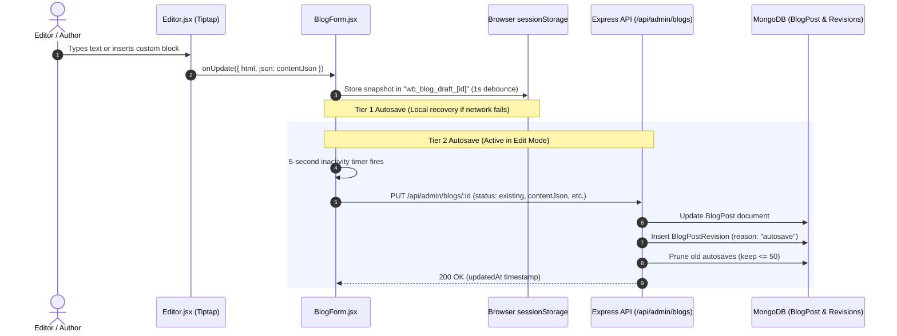
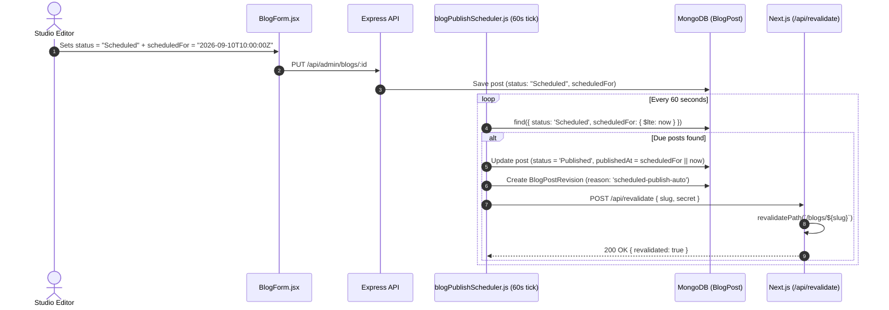
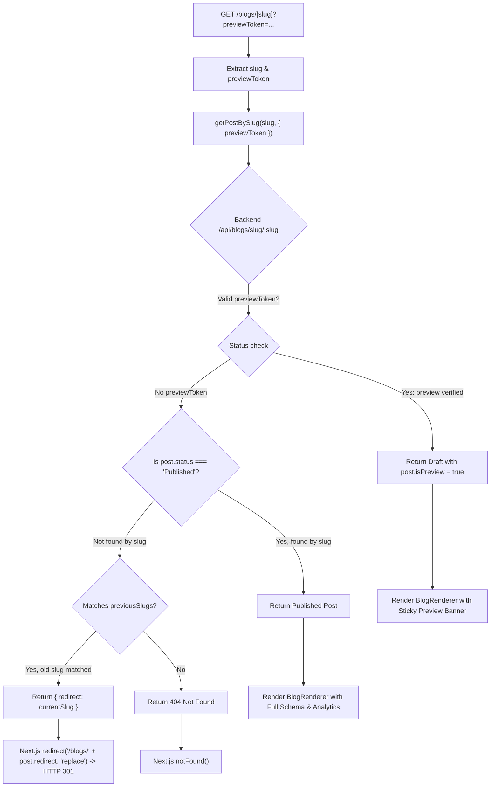
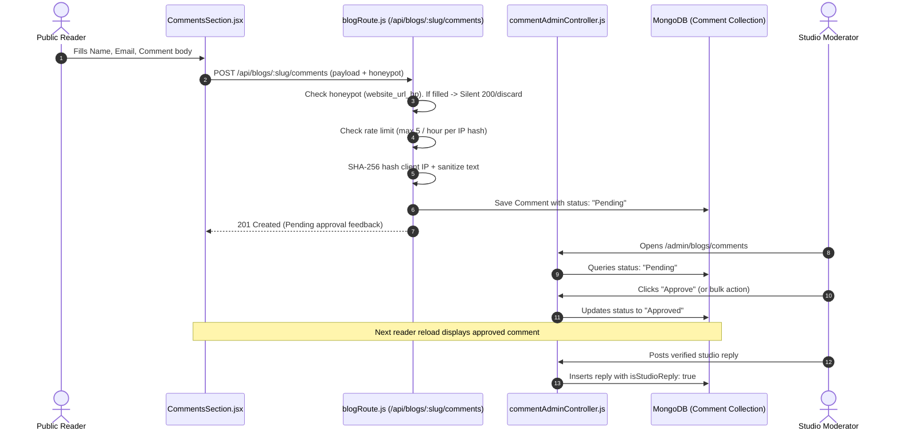

# The Wedding Boys — Subsystem Architecture & How It Works

> **Comprehensive Technical Guide on Data Lifecycles, AST Processing, and Runtime Flows**  
> **Target Audience**: Core Engineers, System Architects & AI Coding Assistants  
> **Status**: Verified in Production

---

## 1. High-Level Architectural Topology

```mermaid
flowchart TD
    subgraph ClientLayer["Edge & Client Tier"]
        AdminBrowser["Studio Editor / Admin Browser"]
        PublicReader["Public Reader / Mobile Browser"]
        AIEdgeBot["Search & Answer Engines (Google, Perplexity)"]
    end

    subgraph NextJSTier["Next.js 16 App Router (Next-Frontend)"]
        AdminDashboard["Admin Dashboard Pages (/admin/blogs/*)"]
        PublicRoutes["Public SSR/ISR Pages (/blogs/*, /weddings/*)"]
        EdgeOG["Edge OG Image Engine (/api/og/blog)"]
        RevalWebhook["ISR Revalidation Endpoint (/api/revalidate)"]
    end

    subgraph ExpressAPITier["Express 4 REST API (Backend)"]
        BlogRouter["Blog Admin & Public Routers"]
        SchedulerCron["Scheduled Publish Cron (60s tick)"]
        AnalyticsCtrl["Telemetry Beacon Collector"]
        CommentCtrl["Spam Filter & Comment Moderation Engine"]
        AuthMiddleware["Admin JWT & Role Verification"]
    end

    subgraph StorageTier["Data & Cache Tier"]
        MongoPrimary[("MongoDB Atlas Collections")]
        SessionCache[("Browser sessionStorage (Draft Recovery)")]
    end

    AdminBrowser -->|HTTPS / Admin JWT| AdminDashboard
    AdminBrowser -->|1s Debounce| SessionCache
    AdminDashboard -->|REST API| BlogRouter
    PublicReader -->|HTTP GET /blogs/[slug]| PublicRoutes
    PublicReader -->|Beacon Event /api/blogs/:slug/track| AnalyticsCtrl
    PublicReader -->|Comment POST| CommentCtrl
    AIEdgeBot -->|Crawl & Rich Snippets| PublicRoutes
    AIEdgeBot -->|Social Card Image Request| EdgeOG

    BlogRouter -->|Mongoose ODM| MongoPrimary
    SchedulerCron -->|Poll Scheduled Posts| MongoPrimary
    SchedulerCron -->|POST Trigger| RevalWebhook
    RevalWebhook -->|Invalidate Page Tag| PublicRoutes
    AnalyticsCtrl -->|Upsert Daily Telemetry| MongoPrimary
    CommentCtrl -->|Insert Moderated Comment| MongoPrimary
```

---

## 2. End-to-End Lifecycle Traces

### Trace A: Authoring, Editing & Dual Autosave Flow

When an author or editor works on a blog post in `/admin/blogs/create` or `/admin/blogs/edit/[id]`, the system executes a dual-tier persistence protocol to guarantee zero data loss:



#### Detailed Steps:
1. **Keystroke & Node Updates**:
   Every keystroke or custom node attribute change in Tiptap fires `editor.on('update')`.
2. **AST Extraction**:
   `Editor.jsx` produces both `html` (using `editor.getHTML()`) and canonical JSON AST (`editor.getJSON()`). Both are passed to `BlogForm.jsx`.
3. **Tier 1 (Client-side Session Storage)**:
   A `useRef` timer debounces 1000ms. If the author refreshes the browser, closes the tab, or suffers an unexpected crash, `BlogForm.jsx` detects the stored draft and presents a restoration banner.
4. **Tier 2 (Server-side Database Revision)**:
   When editing an existing post, a 5-second debounce sends an automatic background `PUT` request to `/api/admin/blogs/:id`.
5. **Revision Pruning**:
   To prevent MongoDB document bloat, the static method `BlogPostRevision.pruneAutosaves(blogId, 50)` automatically keeps the 50 most recent autosaves while permanently retaining manual snapshots and publish checkpoints.

---

### Trace B: Scheduled Publishing & Cache Invalidation

When an editor schedules an article for a future date and time:



#### Key Technical Rules:
- **Zero Drift**: The scheduler uses `{ $lte: now }`, meaning even if the server was temporarily rebooted, any posts that became due while offline will immediately publish upon restart.
- **Cache Eviction**: Publishing triggers an immediate POST to Next.js `/api/revalidate`, wiping the ISR stale cache so the public instantly sees the new story.

---

### Trace C: Public Reader Request, 301 Redirects & Preview Tokens

How Next.js App Router resolves `/blogs/[slug]`:



#### Step Details:
1. **Slug Renaming & Inbound Backlinks (HTTP 301)**:
   If an article was originally published as `/blogs/udaipur-palace-wedding` and later renamed to `/blogs/the-oberoi-udaivilas-wedding`, the old slug is automatically archived into the `previousSlugs` array in MongoDB.
   When a user or search bot hits the old URL, the backend returns `{ redirect: 'the-oberoi-udaivilas-wedding' }`.
   Next.js immediately triggers `redirect('/blogs/the-oberoi-udaivilas-wedding', 'replace')` which emits an HTTP 301 Permanent Redirect, transferring all PageRank and backlink juice.
2. **Preview Token Engine**:
   If an unpublished draft (`Draft` or `InReview`) is accessed, the public endpoint normally returns 404.
   However, passing `?previewToken=<JWT>` verifies the HMAC-SHA256 signature signed with `JWT_SECRET`. If valid and unexpired (24h lifespan), it yields the draft post and injects `post.isPreview = true`.
   The page renders a high-visibility amber warning banner at the top with a direct link back to `/admin/blogs/edit/:id`.

---

### Trace D: Reader Comments & Anti-Spam Pipeline



---

### Trace E: Privacy-First Editorial Analytics & Beacon Telemetry

1. **Client Observer**:
   - `ReadingProgressBar.jsx` monitors the window scroll position.
   - When the user reaches $\ge 90\%$ scroll depth of the article container, a boolean flag `isCompletedRead = true` is marked.
2. **Active Time Tracker**:
   - Time is accumulated only when `document.visibilityState === 'visible'`. If the user switches tabs, tracking pauses.
3. **Discharge on Exit**:
   - On `beforeunload` or component unmount, `navigator.sendBeacon` (falling back to `fetch` with `{ keepalive: true }`) transmits a lightweight JSON payload to `/api/blogs/:slug/track`:
     ```json
     {
       "readTimeSeconds": 45,
       "completed": true,
       "shared": false
     }
     ```
4. **Backend Upsert**:
   - `blogAnalyticsController.js` normalizes the timestamp to the start of the current day (`YYYY-MM-DDT00:00:00.000Z`).
   - Executes an atomic MongoDB `$inc` operation on `BlogDailyStat`:
     ```javascript
     await BlogDailyStat.findOneAndUpdate(
       { blogPost: post._id, date: todayDate },
       {
         $inc: {
           views: 1,
           uniqueVisitors: 1,
           totalReadTimeSeconds: readTimeSeconds,
           completedReads: completed ? 1 : 0,
           shares: shared ? 1 : 0
         }
       },
       { upsert: true, new: true }
     );
     ```

---

## 3. Database Schema Designs & Indexing Strategy

### 1. `BlogPost` Index Strategy
| Index Specification | Purpose | Performance Impact |
|---|---|---|
| `{ slug: 1 }` (unique) | Primary lookup for all public story routing | Sub-millisecond B-Tree point lookup |
| `{ previousSlugs: 1 }` | Fast resolution for 301 redirects on renamed stories | Prevents full table scan on legacy URLs |
| `{ status: 1, publishedAt: -1 }` | Main blog index listing (`/blogs`) filtering published stories | Efficient pagination without in-memory sort |
| `{ category: 1, status: 1, publishedAt: -1 }` | Category-specific filtering | Fast compound index scans |
| `{ status: 1, scheduledFor: 1 }` | Scheduled publishing background cron query | Instant retrieval of due scheduled stories |

### 2. `BlogPostRevision` Index Strategy
| Index Specification | Purpose |
|---|---|
| `{ blogPost: 1, createdAt: -1 }` | Fast timeline retrieval in the editor revision modal |

### 3. `Comment` Index Strategy
| Index Specification | Purpose |
|---|---|
| `{ blogPost: 1, status: 1, createdAt: -1 }` | Rendering approved public comments under a story |
| `{ status: 1, createdAt: -1 }` | Admin moderation queues (*Pending*, *Approved*, *Spam*, *Rejected*) |

### 4. `BlogDailyStat` Index Strategy
| Index Specification | Purpose |
|---|---|
| `{ blogPost: 1, date: -1 }` (unique compound) | Atomic upsert during telemetry beacon ingestion |

---

## 4. Caching & Performance Architecture

1. **Incremental Static Regeneration (ISR)**:
   - Public blog pages export `export const revalidate = 3600;` (1 hour default stale-while-revalidate).
   - Instant cache purging occurs via `POST /api/revalidate` whenever an article is published, edited, or auto-published by cron.
2. **Edge OpenGraph Cards**:
   - `/api/og/blog` executes on the Edge Runtime without Node.js boot overhead.
   - Generates responsive PNG social cards dynamically, cached by Edge CDN.
3. **Preview Mode Cache Bypass**:
   - When `previewToken` is detected, `lib/blogApi.js` automatically sets `{ next: { revalidate: 0 }, cache: 'no-store' }` ensuring reviewers always see fresh draft changes.
