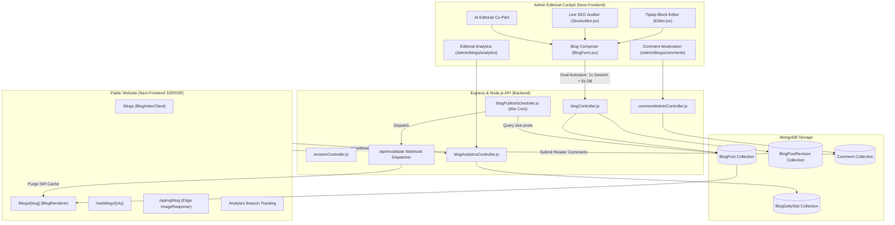
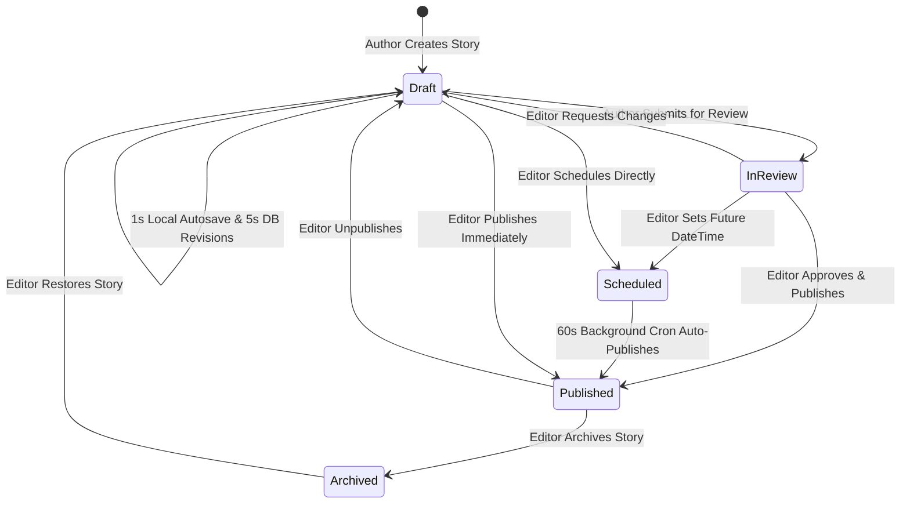

# The Wedding Boys — Enterprise Blog Management Subsystem
## Complete Architecture & Engineering Reference

> **Authoritative Technical Documentation for Engineers & AI Coding Assistants**  
> **Status**: Production Ready (All 6 Phases Completed & Build Verified)  
> **Repository Roots**: `Next-Frontend/` (Next.js 16 App Router) & `Backend/` (Express & MongoDB)  
> **Build Status**: `npm run build` passing with 0 errors across 47 routes.

### 📚 Documentation Suite Navigation
- **[PHASES_COMPLETED.md](file:///Users/akshaysingh/Documents/WebDev/web/weddingBoys/docs/blog-management/PHASES_COMPLETED.md)**: Deep dive into all 6 implemented phases, before/after architectural contrast, and exact file changes.
- **[ARCHITECTURE_AND_HOW_IT_WORKS.md](file:///Users/akshaysingh/Documents/WebDev/web/weddingBoys/docs/blog-management/ARCHITECTURE_AND_HOW_IT_WORKS.md)**: End-to-end data lifecycle traces (authoring, dual autosave, scheduled cron, 301 redirects, comments, and analytics telemetry).
- **[LLM_CONTEXT.md](file:///Users/akshaysingh/Documents/WebDev/web/weddingBoys/docs/blog-management/LLM_CONTEXT.md)**: Dedicated system prompt and operational guide for AI coding assistants (invariants, recipes, common gotchas, and error playbooks).

---

## 1. Executive Summary & System Overview

The **Blog Management Subsystem** is an enterprise-grade, luxury editorial content engine engineered for **The Wedding Boys**, an ultra-luxury cinematic wedding film and fine art photography studio in India (with destination hubs across Udaipur, Jaipur, Goa, Varanasi, Mumbai, and Delhi).

The system replaces legacy monolithic HTML blogs with an extensible, **JSON Abstract Syntax Tree (AST)** driven publishing platform. It bridges editorial storytelling with studio portfolio cross-linking, advanced Answer Engine Optimization (AEO), automated background publishing, multi-tier editorial governance, real-time readability auditing, and edge performance analytics.

### Core Capabilities
1. **Block-Based Visual Composition**: Powered by **Tiptap v2** with 10 custom studio block extensions (Pull Quotes, At-a-Glance stats, Vendor Credits, FAQ accordions, Enquiry CTAs, Responsive Photo Galleries, and Multi-Provider Video Facades).
2. **Luxury Editorial Templating**: 4 distinct aesthetic layouts tailored to story type (*Cinematic Real Wedding*, *Editorial Guide*, *Photo Essay*, and *Minimal Journal*).
3. **Multi-Tier Editorial Governance**: Role-based state machine (`Draft` $\rightarrow$ `InReview` $\rightarrow$ `Scheduled` $\rightarrow$ `Published` $\rightarrow$ `Archived`) guarding publication privileges to `Editor` and `SuperAdmin` roles.
4. **Automated Scheduled Publishing**: Self-healing 60-second background cron engine that publishes due stories, generates snapshot revisions, and invalidates Edge CDN caches on demand.
5. **Slug Immutability & 301 Redirects Engine**: Automatic previous slug tracking ensuring search rank and inbound backlinks are permanently preserved with HTTP 301 redirects upon story renaming.
6. **Time-Limited Signed Preview Links**: Cryptographic 24-hour HMAC-SHA256 preview tokens allowing external clients and reviewers to view unpublished drafts without admin authentication.
7. **AI Editorial Co-Pilot**: In-editor assistant providing SERP title/description optimization, mood-based story teaser generation, SEO keyword expansion, and venue FAQ drafting.
8. **Community Comment Moderation**: Reader comments pipeline with client IP hashing, honeypot spam traps, and a dedicated admin moderation queue with verified studio replies and comment pinning.
9. **Real-Time Editorial Analytics**: Privacy-first beacon telemetry tracking unique visitors, read completion rate, average engagement time, and shares.
10. **AEO & Programmatic SEO Engine**: Edge OpenGraph dynamic social card generation, full Google Rich Results Schema suite (`HowTo`, `VideoObject`, `BlogPosting`, `FAQPage`), live 11-rule SEO auditor, and programmatic destination wedding landing hubs (`/weddings/[city]`).

---

## 2. System Architecture & Data Flow



---

## 3. Database Schema Models

### A. `BlogPost` Model
**File**: [`Backend/Models/blogPost.js`](file:///Users/akshaysingh/Documents/WebDev/web/weddingBoys/Backend/Models/blogPost.js)  
The central entity representing an editorial story.

```javascript
{
  title: { type: String, required: true, trim: true },
  slug: { type: String, required: true, unique: true, trim: true },
  previousSlugs: [{ type: String, trim: true }], // Indexed for fast 301 redirects

  // Content Dual-Store
  content: { type: String, required: true }, // Sanitized HTML cache for SSR fallback
  contentJson: { type: mongoose.Schema.Types.Mixed }, // Authoritative Tiptap AST JSON

  excerpt: { type: String, maxlength: 200, required: true },
  template: {
    type: String,
    enum: ['cinematic-real-wedding', 'editorial-guide', 'photo-essay', 'minimal-journal'],
    default: 'editorial-guide'
  },

  // Media references (polymorphic Media collection)
  coverImage: { type: mongoose.Schema.Types.ObjectId, ref: 'Media' },
  gallery: [{ type: mongoose.Schema.Types.ObjectId, ref: 'Media' }],
  inlineMedia: [{ type: mongoose.Schema.Types.ObjectId, ref: 'Media' }],

  // Attribution
  author: { type: mongoose.Schema.Types.ObjectId, ref: 'Admin', required: true },
  contributors: [{ type: mongoose.Schema.Types.ObjectId, ref: 'Admin' }],

  // Taxonomy & Search
  category: {
    type: String,
    enum: ['Real Weddings', 'Wedding Planning', 'Photography', 'Decor & Styling', 'Venues', 'Bridal Fashion', 'Tips & Advice', 'Destination'],
    default: 'Real Weddings',
    index: true
  },
  tags: [{ type: String, lowercase: true, trim: true }],
  keywords: [{ type: String, trim: true }],
  focusKeyword: { type: String, trim: true },

  // Workflow Lifecycle
  status: {
    type: String,
    enum: ['Draft', 'InReview', 'Scheduled', 'Published', 'Archived'],
    default: 'Draft',
    index: true
  },
  publishedAt: { type: Date, index: -1 },
  scheduledFor: { type: Date },

  // Editorial Metadata
  readingTime: { type: Number, default: 1 },
  tableOfContents: [{
    level: Number,
    text: String,
    id: String
  }],
  seoScore: { type: Number, default: 0 },
  allowComments: { type: Boolean, default: true },

  // Structured Story Metadata (Used in At-A-Glance and Wedding Story Footers)
  mood: { type: String, enum: ['romantic', 'elegant', 'rustic', 'modern', 'vintage', 'bohemian', 'fun', 'intimate', ''] },
  season: { type: String, enum: ['Spring', 'Summer', 'Monsoon', 'Autumn', 'Winter', ''] },
  budget: String,
  venue: String,
  style: String,
  testimonial: String,

  // Curated Partner Credits & FAQs
  vendorCredits: [{
    category: String,
    name: String,
    instagram: String,
    website: String
  }],
  faq: [{
    question: String,
    answer: String
  }],
  howToSteps: [{
    name: String,
    text: String,
    image: String
  }]
}
```

### B. `BlogPostRevision` Model
**File**: [`Backend/Models/BlogPostRevision.js`](file:///Users/akshaysingh/Documents/WebDev/web/weddingBoys/Backend/Models/BlogPostRevision.js)  
Tracks automated and manual edit revisions with rollback capabilities.

```javascript
{
  blogPost: { type: mongoose.Schema.Types.ObjectId, ref: 'BlogPost', required: true, index: true },
  title: String,
  contentJson: mongoose.Schema.Types.Mixed, // Complete AST snapshot
  excerpt: String,
  template: String,
  editedBy: { type: mongoose.Schema.Types.ObjectId, ref: 'Admin' },
  reason: {
    type: String,
    enum: ['autosave', 'manual-save', 'publish-snapshot', 'restore-backup', 'scheduled-publish-auto'],
    default: 'autosave'
  },
  createdAt: { type: Date, default: Date.now, index: -1 }
}
```
*Features static method `BlogPostRevision.pruneAutosaves(blogPostId, limit = 50)` ensuring revision storage remains bounded.*

### C. `Comment` Model
**File**: [`Backend/Models/Comment.js`](file:///Users/akshaysingh/Documents/WebDev/web/weddingBoys/Backend/Models/Comment.js)  
Moderated reader engagement and studio replies.

```javascript
{
  blogPost: { type: mongoose.Schema.Types.ObjectId, ref: 'BlogPost', required: true, index: true },
  authorName: { type: String, required: true, trim: true, maxlength: 60 },
  authorEmail: { type: String, required: true, trim: true, lowercase: true },
  body: { type: String, required: true, trim: true, maxlength: 2000 },
  status: {
    type: String,
    enum: ['Pending', 'Approved', 'Spam', 'Rejected'],
    default: 'Pending',
    index: true
  },
  isPinned: { type: Boolean, default: false },
  isStudioReply: { type: Boolean, default: false },
  parentComment: { type: mongoose.Schema.Types.ObjectId, ref: 'Comment', default: null },
  ipHash: { type: String, select: false }, // SHA-256 hashed for privacy compliance
  userAgent: { type: String, select: false }
}
```

### D. `BlogDailyStat` Model
**File**: [`Backend/Models/BlogDailyStat.js`](file:///Users/akshaysingh/Documents/WebDev/web/weddingBoys/Backend/Models/BlogDailyStat.js)  
Daily aggregated telemetry for article performance.

```javascript
{
  blogPost: { type: mongoose.Schema.Types.ObjectId, ref: 'BlogPost', required: true },
  date: { type: Date, required: true }, // Normalized to YYYY-MM-DDT00:00:00.000Z
  views: { type: Number, default: 0 },
  uniqueVisitors: { type: Number, default: 0 },
  totalReadTimeSeconds: { type: Number, default: 0 },
  completedReads: { type: Number, default: 0 }, // Reached bottom of article
  shares: { type: Number, default: 0 },
  commentsCount: { type: Number, default: 0 }
}
```
*Indexed by `{ blogPost: 1, date: -1 }` (unique compound index).*

---

## 4. Complete Breakdown of the 6 Implementation Phases

### Phase 1: Content Architecture & Editor Rebuild
- **AST Canonicalization**: The system transitioned from vulnerable raw HTML strings to a strictly typed Tiptap JSON Abstract Syntax Tree (`contentJson`). HTML is derived as a cached read model.
- **Custom Studio Block Nodes**:
  - `InlineMedia.jsx`: Full/center/left/right aligned image figures with blur placeholders, captions, and LCP priority tags.
  - `PhotoGallery.jsx`: 2-column or 3-column masonry photo essays.
  - `WeddingVideoEmbed.jsx`: Adaptive 16:9 streaming players for Cloudflare Stream (`streamUid`), Vimeo, YouTube, and direct MP4s.
  - `Embed.jsx`: Multi-provider interactive card for Spotify ceremony playlists, Google Maps venue pins, Instagram reels, and Pinterest moodboards.
  - `Callout.jsx`: Editorial accent boxes (`note`, `vendor`, `testimonial`).
  - `PullQuote.jsx`: Luxury serif drop-quote with Playfair Display styling.
  - `AtAGlance.jsx`: High-level wedding stats strip (Venue, Season, Budget, Style, Mood).
  - `VendorCredits.jsx`: Curated vendor partner credits with clean follow links.
  - `FAQ.jsx`: Accordion questions with automated FAQPage schema markup.
  - `EnquiryCTA.jsx`: High-converting lead-capture call-to-action block.
- **Dual Autosave Engine**:
  - *Tier 1*: 1-second debounced local backup in browser `sessionStorage` (`wb_blog_draft_[id]`) with one-click restoration if a session drops.
  - *Tier 2*: 5-second idle debounce in edit mode saving background `autosave` snapshots to `BlogPostRevision`.
- **Snapshot Revision History**: Dedicated modal in `BlogForm` displaying timeline of edits, diff view, author stamps, and one-click rollback.

### Phase 2: Luxury Editorial Presentation & Templating System
- **4 Bespoke Templates**:
  1. *Editorial Guide* (`EditorialGuide.jsx`): Center-column reading measure, sticky table of contents rail, structured advice, FAQ accordions.
  2. *Cinematic Real Wedding* (`CinematicRealWedding.jsx`): Full-bleed cinematic hero, couple metadata overlay, At-A-Glance strip, couple quote, vendor credits footer.
  3. *Photo Essay* (`PhotoEssay.jsx`): Edge-to-edge visual masonry, minimal prose, large format gallery emphasis.
  4. *Minimal Journal* (`MinimalJournal.jsx`): Refined editorial typography, generous whitespace, focus on intimate storytelling.
- **Block Registry Renderer** (`BlogRenderer.jsx`): Replaces unsafe `dangerouslySetInnerHTML` with an AST-driven block renderer recursively mapping node types to React components.
- **Interactive Reader Features**:
  - Sticky top reading progress bar (`ReadingProgressBar.jsx`) with scroll percentage.
  - Dynamic Table of Contents (`TableOfContents.jsx`) tracking active section in viewport.
  - Social share links (`ShareLinks.jsx`) for WhatsApp, Pinterest, X/Twitter, and clipboard copy.
  - Adjacent story recommendation cards (`NextPrevStories.jsx`).
  - Studio newsletter subscription capture box (`NewsletterCapture.jsx`).

### Phase 3: Interactive Engagement & Community Moderation Engine
- **Public Comment Submission**: Public endpoint `POST /api/blogs/:slug/comments` with:
  - Rate limiting (max 5 comments per hour per IP hash).
  - Invisible honeypot field (`website_url_hp`) discarding automated bot submissions.
  - Content sanitization (strips malicious script tags and HTML injection).
- **Admin Moderation Dashboard** ([`app/admin/(dashboard)/blogs/comments/page.jsx`](file:///Users/akshaysingh/Documents/WebDev/web/weddingBoys/Next-Frontend/app/admin/(dashboard)/blogs/comments/page.jsx)):
  - 4 status queues: *Pending Approval*, *Approved*, *Spam*, and *Rejected*.
  - Quick actions: Single or bulk Approve, Reject, Mark as Spam, and Permanent Delete.
  - Pinning: Highlight top comments at the top of the article.
  - Verified Studio Reply: Administrators can post official replies bearing the studio badge.
- **Public Discussion Thread** (`CommentsSection.jsx`): Collapsible discussion list rendered directly under the blog post.

### Phase 4: Editorial Intelligence & Real-Time Performance Analytics
- **Telemetry Beacon**: Client-side lightweight tracking sending heartbeat beacons upon scroll and exit to `/api/blogs/:slug/track`.
- **Aggregate Metrics**: Tracked daily in `BlogDailyStat`:
  - Total Views & Unique Visitors.
  - Average Active Read Time (seconds).
  - Read Completion Rate (% of readers scrolling through $\ge 90\%$ of article body).
  - Social Shares and Comments Generated.
- **Editorial Analytics Dashboard** ([`app/admin/(dashboard)/blogs/analytics/page.jsx`](file:///Users/akshaysingh/Documents/WebDev/web/weddingBoys/Next-Frontend/app/admin/(dashboard)/blogs/analytics/page.jsx)):
  - Top-line KPI summary cards (Total Impressions, Average Read Time, Average Completion Rate).
  - Leaderboard ranking top performing stories by readership and engagement score.
  - Template & category performance distribution breakdown.

### Phase 5: SEO, AEO & Scale Engine
- **Edge Dynamic OpenGraph Generator** ([`app/api/og/blog/route.jsx`](file:///Users/akshaysingh/Documents/WebDev/web/weddingBoys/Next-Frontend/app/api/og/blog/route.jsx)):
  - Runs on Next.js Edge runtime via `@vercel/og` (`ImageResponse`).
  - Dynamically synthesizes 1200×630 luxury social cards featuring dark charcoal canvas (`#12100E`), ambient gold radial lighting, terracotta studio masthead, responsive serif titles, and destination/category badges.
- **Google Rich Results Schema Suite**:
  - `BlogPosting`: Author, publisher, datePublished, dateModified, and comment indexation.
  - `BreadcrumbList`: Complete hierarchical breadcrumbs (`Home` > `Blog` > `Category` > `Story`).
  - `FAQPage`: Injected when `post.faq` items exist.
  - `HowTo`: Emitted when structured planning guide steps are defined.
  - `VideoObject`: Scans AST for embedded films (YouTube, Vimeo, Cloudflare) and emits compliant video metadata.
- **In-Editor SEO & Readability Auditor** (`SeoAuditor.jsx`):
  - Algorithmic composite score (0–100%) calculated live against 11 criteria: Focus keyword density and placement, title/description character thresholds, heading hierarchy, paragraph pacing, and image alt-text coverage.
- **Programmatic Destination Hubs** ([`app/(site)/weddings/[city]/page.jsx`](file:///Users/akshaysingh/Documents/WebDev/web/weddingBoys/Next-Frontend/app/(site)/weddings/[city]/page.jsx)):
  - Pre-rendered static landing pages for India's premier wedding destinations (*Udaipur*, *Jaipur*, *Goa*, *Jodhpur*, *Varanasi*, *Mumbai*, *Kerala*).
  - Contains destination filming guides, venue recommendations, local photography tips, destination FAQs, and real stories matching that city.
- **Dynamic XML Sitemap & ISR Webhooks**:
  - [`app/sitemap.js`](file:///Users/akshaysingh/Documents/WebDev/web/weddingBoys/Next-Frontend/app/sitemap.js): Auto-generates complete sitemap including all published articles and destination hubs.
  - [`app/api/revalidate/route.js`](file:///Users/akshaysingh/Documents/WebDev/web/weddingBoys/Next-Frontend/app/api/revalidate/route.js): Authenticated secret webhook triggering instant Next.js App Router cache invalidation.

### Phase 6: Editorial Governance & Publishing Workflow
- **Role-Based Permissions**: Backend guards in `blogController.js` enforcing that only `SuperAdmin` and `Editor` roles can set status to `Published` or `Scheduled`. Authors can only transition `Draft` $\leftrightarrow$ `InReview`.
- **Slug Immutability & 301 Permanent Redirects**:
  - Renaming an existing published slug automatically appends the prior slug to `previousSlugs`.
  - Inbound traffic to legacy URLs is resolved by `getPostBySlug` and redirected using Next.js `redirect('/blogs/' + post.redirect, 'replace')` (HTTP 301).
- **Background Scheduled Publishing Service** (`blogPublishScheduler.js`):
  - 60-second cron polling for due `Scheduled` posts.
  - Automatically flips status to `Published`, stamps `publishedAt`, creates a snapshot revision, and dispatches the ISR revalidation webhook to Next.js.
- **Signed 24-Hour Preview Links**:
  - Endpoint `GET /api/admin/blogs/:id/preview-token` issues HMAC-SHA256 JWT tokens.
  - External reviewers and couples can view drafts at `/blogs/:slug?previewToken=...` with a luxury preview banner, bypassing publication filters.
- **AI Editorial Co-Pilot** (`EditorialAiCopilot.jsx`):
  - Instant generation for SERP meta title/description, wedding story teasers, keyword expansion, and venue FAQs with 1-click form injection.
- **Studio Client Portfolio Showcase Cross-Linking**:
  - `ClientShowcasePickerModal.jsx` searches client films from `/api/admin/embed/clients`.
  - 1-click insertion into Tiptap via toolbar button or slash command `/client`.

---

## 5. Complete API Reference

### A. Admin Endpoints (Require Admin JWT Cookie)
**File**: [`Backend/Routes/Admin/blogsRoute.js`](file:///Users/akshaysingh/Documents/WebDev/web/weddingBoys/Backend/Routes/Admin/blogsRoute.js)

| Method | Endpoint | Description |
|---|---|---|
| `GET` | `/api/admin/blogs` | Get all articles (all statuses, sorted by `-createdAt`). |
| `GET` | `/api/admin/blogs/analytics` | Get aggregate editorial performance metrics & top stories. |
| `GET` | `/api/admin/blogs/:id` | Get full article document by ObjectId. |
| `POST` | `/api/admin/blogs` | Create a new blog story (role-guarded status check). |
| `PUT` | `/api/admin/blogs/:id` | Update story, AST, and metadata (records previous slug if renamed). |
| `PUT` | `/api/admin/blogs/:id/publish` | Toggle publication state (`Published`, `Draft`, `Scheduled`, `Archived`). |
| `DELETE` | `/api/admin/blogs/:id` | Delete article and archive associated media assets. |
| `GET` | `/api/admin/blogs/:id/preview-token` | Generate signed 24-hour preview JWT for unpublished story. |
| `GET` | `/api/admin/blogs/:id/revisions` | Fetch list of revision history snapshots. |
| `POST` | `/api/admin/blogs/:id/revisions` | Create a manual revision snapshot. |
| `POST` | `/api/admin/blogs/:id/revisions/:revId/restore` | Restore article state from a previous revision. |
| `GET` | `/api/admin/comments` | Fetch moderated comment queues (`Pending`, `Approved`, `Spam`, `Rejected`). |
| `PUT` | `/api/admin/comments/:id/status` | Update single comment status. |
| `PUT` | `/api/admin/comments/bulk` | Bulk approve, spam, reject, or delete comments. |
| `POST` | `/api/admin/comments/:id/reply` | Post an official verified studio reply to a comment. |
| `PUT` | `/api/admin/comments/:id/pin` | Pin or unpin a comment to the top of the discussion. |

### B. Public Endpoints
**File**: [`Backend/Routes/User/blogRoute.js`](file:///Users/akshaysingh/Documents/WebDev/web/weddingBoys/Backend/Routes/User/blogRoute.js)

| Method | Endpoint | Description |
|---|---|---|
| `GET` | `/api/blogs` | Paginated list of published stories (`?page=1&limit=12&category=...`). |
| `GET` | `/api/blogs/slug/:slug` | Retrieve single story by slug (supports `?previewToken=...` for drafts; returns `{ redirect }` if slug was renamed). |
| `GET` | `/api/blogs/related/:slug` | Fetch 3 contextually related stories matching category and tags. |
| `POST` | `/api/blogs/:slug/comments` | Submit reader comment (rate-limited, honeypot protected). |
| `GET` | `/api/blogs/:slug/comments` | Fetch approved comment thread and pinned comments. |
| `POST` | `/api/blogs/:slug/track` | Heartbeat analytics telemetry beacon. |

---

## 6. Frontend Component Architecture & Directory Map

```
Next-Frontend/
├── app/
│   ├── (site)/
│   │   ├── blogs/
│   │   │   ├── page.jsx                        # Public Blog Index (Hero, Category tabs, Grid)
│   │   │   ├── [slug]/page.jsx                 # Public Story Route (SSR, ISR, 301 handler, Preview Mode)
│   │   │   └── _components/
│   │   │       ├── BlogIndexClient.jsx         # Searchable, filterable client story masonry
│   │   │       ├── CommentsSection.jsx         # Reader comments list & submission form
│   │   │       ├── NewsletterCapture.jsx       # Email lead capture component
│   │   │       ├── NextPrevStories.jsx         # Adjacent story navigation
│   │   │       ├── ReadingProgressBar.jsx      # Top sticky scroll progress indicator
│   │   │       ├── ShareLinks.jsx              # Social share buttons & clipboard copy
│   │   │       └── TableOfContents.jsx         # Desktop sticky TOC with active highlight
│   │   └── weddings/[city]/page.jsx            # Programmatic Indian Destination Hubs
│   │
│   ├── admin/(dashboard)/blogs/
│   │   ├── page.jsx                            # Admin Stories Dashboard (5-stage tabs, quick actions)
│   │   ├── create/page.jsx                     # New Story Composer (<BlogForm mode="create" />)
│   │   ├── edit/[id]/page.jsx                  # Edit Story Composer (<BlogForm mode="edit" />)
│   │   ├── comments/page.jsx                   # Comment Moderation Dashboard (4 queues, batch actions)
│   │   ├── analytics/page.jsx                  # Editorial Intelligence Analytics Dashboard
│   │   └── _components/
│   │       ├── BlogForm.jsx                    # Unified Article Composer & Sidebar Controls
│   │       ├── Editor.jsx                      # Tiptap Rich Text Editor & Sticky Toolbar
│   │       ├── EditorialAiCopilot.jsx          # AI Editorial Assistant Drawer
│   │       ├── ClientShowcasePickerModal.jsx   # Portfolio Cinema Cross-Linking Modal
│   │       ├── EmbedModal.jsx                  # Rich Media Embed Modal (YouTube, Spotify, Maps, etc.)
│   │       ├── SeoAuditor.jsx                  # Live 11-Rule SEO & Readability Auditor
│   │       └── extensions/                     # Custom Tiptap Block Extension Nodes
│   │           ├── AtAGlance.jsx
│   │           ├── Callout.jsx
│   │           ├── Embed.jsx
│   │           ├── EnquiryCTA.jsx
│   │           ├── FAQ.jsx
│   │           ├── InlineMedia.jsx
│   │           ├── PhotoGallery.jsx
│   │           ├── PullQuote.jsx
│   │           ├── VendorCredits.jsx
│   │           └── WeddingVideoEmbed.jsx
│   │
│   └── api/
│       ├── og/blog/route.jsx                   # Edge Dynamic OpenGraph Social Image Generator
│       └── revalidate/route.js                 # On-Demand ISR Cache Invalidation Webhook
│
└── lib/
    ├── blogApi.js                              # Client fetch wrapper with previewToken support
    ├── weddingLocations.js                     # Curated Indian destination database
    └── blog/
        ├── BlogRenderer.jsx                    # Core AST Block Registry Renderer
        └── templates/                          # 4 Bespoke Editorial Templates
            ├── CinematicRealWedding.jsx
            ├── EditorialGuide.jsx
            ├── MinimalJournal.jsx
            └── PhotoEssay.jsx
```

---

## 7. Editorial Governance & Publishing Lifecycle



### Role Access Matrix
| Action | Author | Editor | SuperAdmin |
|---|:---:|:---:|:---:|
| Create / Edit Own Drafts | Yes | Yes | Yes |
| Submit for Review (`InReview`) | Yes | Yes | Yes |
| Approve & Publish Immediately | No (403) | Yes | Yes |
| Schedule for Future Publication | No (403) | Yes | Yes |
| Unpublish / Revert to Draft | No (403) | Yes | Yes |
| Generate Signed Preview Link | Yes | Yes | Yes |
| Restore Previous Revisions | Yes | Yes | Yes |
| Moderate Comments | No | Yes | Yes |
| View Editorial Analytics | Yes | Yes | Yes |

---

## 8. SEO, AEO & Analytics Pipeline

### 1. Answer Engine Optimization (AEO) Strategy
AI search engines (Perplexity, ChatGPT Search, Google AI Overviews) parse structured entity relationships rather than simple keywords. The system implements:
- **`HowTo` schema** for planning guides detailing exact equipment, prep steps, and timing.
- **`VideoObject` schema** associating each embedded film with its exact transcript, duration, and thumbnail.
- **`FAQPage` schema** formatting questions for instant answer extraction.
- **`TouristDestination` + `Place` schema** on destination hubs (`/weddings/[city]`) establishing geographic authority.

### 2. Live SEO Auditor Rules (0–100% Score)
Implemented in [`SeoAuditor.jsx`](file:///Users/akshaysingh/Documents/WebDev/web/weddingBoys/Next-Frontend/app/admin/(dashboard)/blogs/_components/SeoAuditor.jsx):
1. Focus keyword present in Story Title.
2. Focus keyword present in Excerpt / Meta Description.
3. Focus keyword present in first 150 words of body text.
4. Focus keyword present in at least one H2 or H3 heading.
5. Meta title length within ideal SERP bracket (30–60 characters).
6. Meta description length within ideal snippet bracket (120–160 characters).
7. Content depth $\ge 600$ words.
8. Paragraph length (warns if paragraphs exceed 100 words without break).
9. Heading hierarchy (ensures H2 precedes H3).
10. Image alt-text coverage ($100\%$ required for full score).
11. Visual density (at least 1 image or video per 350 words).

---

## 9. Design System & Studio Styling Tokens

All editorial components strictly adhere to The Wedding Boys luxury studio design language:

| Design Token | CSS / Hex Code | Usage |
|---|---|---|
| **Porcelain Canvas** | `#F7F4EF` / `bg-[#F7F4EF]` | Background for site mastheads, admin dashboards, and dialogs. |
| **Studio Border** | `#E5DCD3` / `border-[#E5DCD3]` | Subtle hairline dividers and card outlines. |
| **Obsidian Charcoal** | `#1C1917` / `text-[#1C1917]` | Primary editorial text, high-contrast headings, primary buttons. |
| **Terracotta Accent** | `#8C532B` / `text-[#8C532B]` | Studio badge highlights, active tabs, icon accents, pull-quotes. |
| **Warm Gold** | `#C29555` | Gradient overlays, high-priority action buttons (`variant="gold"`). |
| **Muted Ink** | `#78716C` | Body metadata, timestamps, author credits, character counters. |
| **Typography** | `Inter` (`font-sans`) + `Playfair Display` (`font-playfair`) | Inter for high-legibility UI/body; Playfair Display for editorial headlines and pull-quotes. |

---

## 10. Developer & AI Assistant Cheatsheet

### Common Gotchas & Best Practices

1. **Avoid Hydration Mismatches on Dates**:
   - Always specify explicit locales on dates in client components, e.g.:
     ```jsx
     <span suppressHydrationWarning>
       {new Date(date).toLocaleDateString('en-US', { month: 'short', day: 'numeric', year: 'numeric' })}
     </span>
     ```
   - Never call `toLocaleDateString()` with `undefined` or without options in components that SSR.

2. **Route Order in Express**:
   - In [`Backend/Routes/Admin/blogsRoute.js`](file:///Users/akshaysingh/Documents/WebDev/web/weddingBoys/Backend/Routes/Admin/blogsRoute.js), all static subroutes (`/analytics`, `/comments`, `/presigned-urls`) **must be defined before** the parameterized `/:id` route.
   - In [`Backend/app.js`](file:///Users/akshaysingh/Documents/WebDev/web/weddingBoys/Backend/app.js), `adminBlogAnalyticsRoute` must be mounted before `blogsRoute`.

3. **Mongoose `ObjectId` Validation**:
   - Any controller handler extracting `req.params.id` must guard with:
     ```javascript
     if (!mongoose.Types.ObjectId.isValid(id)) {
       return res.status(404).json({ error: 'Blog not found' });
     }
     ```

4. **Tiptap AST Synchronization**:
   - `BlogRenderer.jsx` reads `post.contentJson`.
   - If `contentJson` is absent (legacy posts), it falls back to `content` (HTML string).
   - When saving from `Editor.jsx`, always pass both `html` and `json`:
     `onUpdate({ html: editor.getHTML(), json: editor.getJSON() })`.

5. **ISR Revalidation Secret**:
   - Webhook dispatches to Next.js require header secret matching `process.env.REVALIDATION_SECRET || 'wb_editorial_secret_2026'`.
